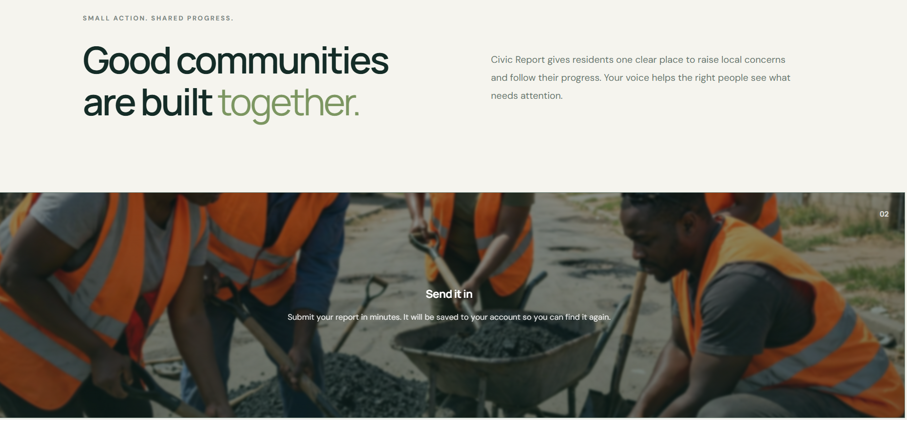
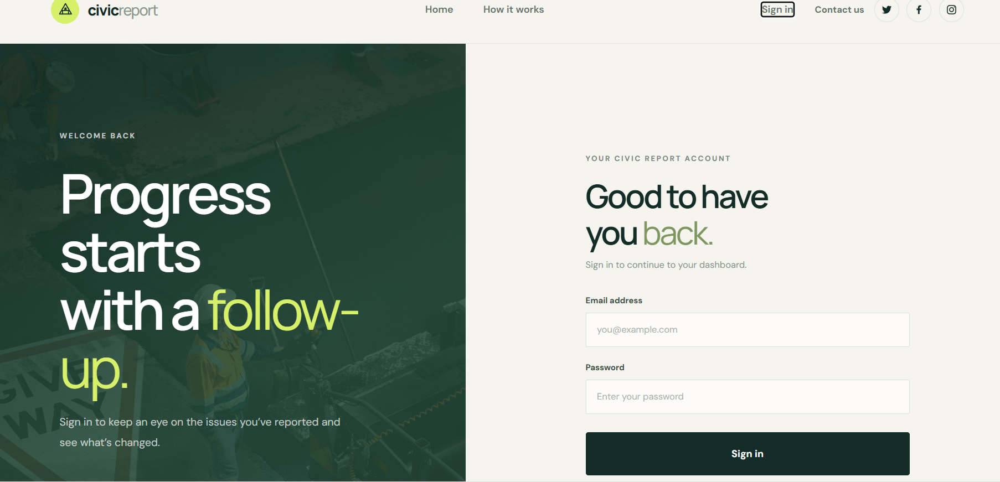
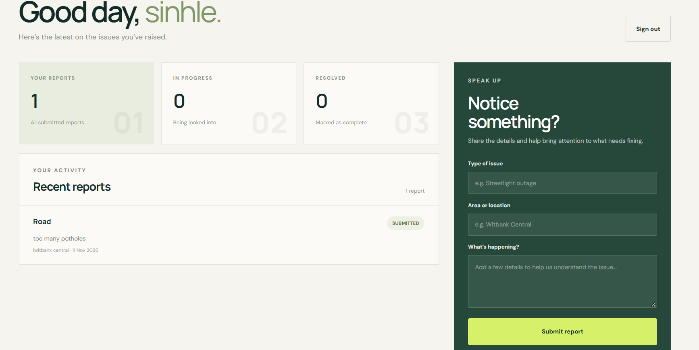
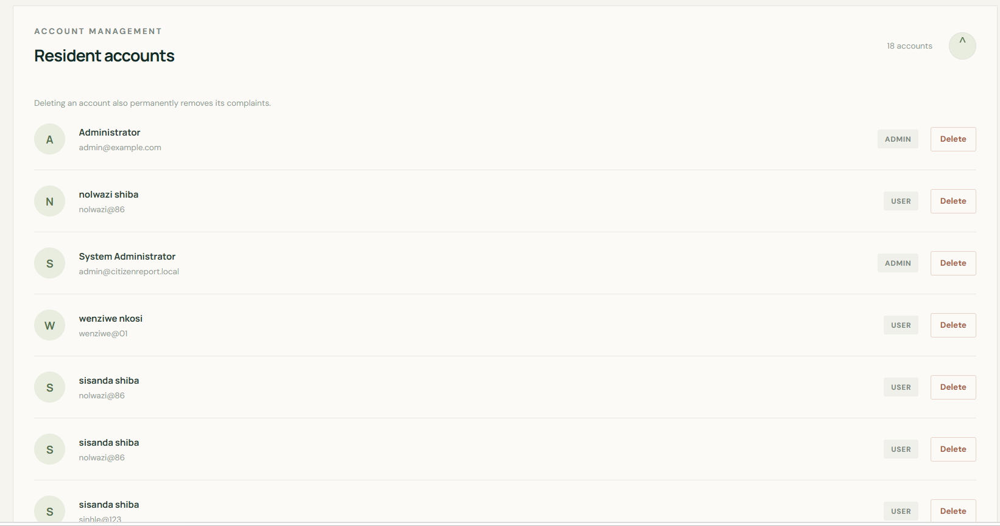
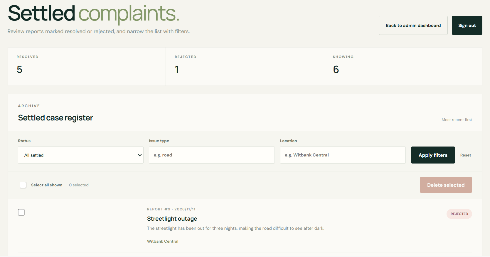

# Citizen Report

Citizen Report is a community service reporting system for Witbank. Residents can submit local issues and follow their progress, while administrators can manage users and resolve reports.

The project combines a Spring Boot REST API with a browser-based frontend served by the application.

## Features

### Resident features

- Register an account and sign in.
- Submit a complaint with its issue type, description, and location.
- View submitted complaints and their current status.

### Administrator features

- View and filter complaints by status, issue type, and location.
- Update complaint statuses and review settled complaints.
- Create, view, update, and delete user accounts.

### Security

- Public registration assigns new accounts the `USER` role.
- Protected API requests use short-lived JWT bearer tokens.
- Administrator access must be granted through a controlled database operation.

## Screenshots

These screenshots are stored in the repository's `screenshots/` folder. Select an image to open it at full size.

### Home pages

[](screenshots/HOMEPAGE1.png)

[](screenshots/homePage2.png)

### Account pages

[](screenshots/SIGNIN.png)

[](screenshots/register.png)

### User dashboard

[](screenshots/Userdashboard.png)

### Admin dashboards

[](screenshots/admin.png)

[](screenshots/admin2.png)

[](screenshots/admin3.png)

## Technology

- Java 17
- Spring Boot 3.5
- Spring Web, Spring Data JPA, Spring Security, and Bean Validation
- MySQL
- HTML, CSS, and JavaScript
- Maven (Maven Wrapper included)

## Run locally

### Requirements

- Java 17 or later
- MySQL
- A MySQL database named `citizen_report_db`

Set the database password and generate a private JWT signing key in PowerShell, then start the application:

```powershell
$env:DB_PASSWORD = "your-database-password"
$bytes = New-Object byte[] 32
$rng = [System.Security.Cryptography.RandomNumberGenerator]::Create()
$rng.GetBytes($bytes)
$env:JWT_SECRET_BASE64 = [Convert]::ToBase64String($bytes)
$rng.Dispose()
.\mvnw.cmd spring-boot:run
```

The frontend is served at `http://localhost:8081/`. The database username defaults to `root`, and the database URL defaults to `jdbc:mysql://localhost:3306/citizen_report_db`. Set `DB_USERNAME` or `DB_URL` to override those defaults.

The JWT key must remain private. Keep the same key between restarts if existing tokens need to remain valid. SMTP configuration is optional; set `MAIL_HOST`, `MAIL_USERNAME`, and `MAIL_PASSWORD` to send registration emails.

## API overview

All request and response bodies use JSON. Protected endpoints require:

```text
Authorization: Bearer <accessToken>
```

| Method | Endpoint | Access |
| --- | --- | --- |
| `POST` | `/api/auth/register` | Public |
| `POST` | `/api/auth/login` | Public; returns an access token |
| `GET` | `/api/auth/me` | Signed in |
| `GET`, `POST` | `/api/complaints` | Signed in |
| `GET` | `/api/complaints/{id}` | Complaint owner or admin |
| `GET` | `/api/admin/complaints` | Admin; supports optional filters |
| `GET` | `/api/admin/complaints/settled` | Admin; settled complaints |
| `PATCH` | `/api/admin/complaints/{id}/status` | Admin |
| `DELETE` | `/api/admin/complaints/{id}` | Admin; resolved or rejected complaints |
| `GET`, `POST` | `/api/users` | Admin |
| `GET`, `PUT`, `DELETE` | `/api/users/{id}` | Admin |

Complaint statuses are `SUBMITTED`, `IN_PROGRESS`, `RESOLVED`, and `REJECTED`. A complaint can be deleted by an administrator only after it has been resolved or rejected.

## Project layout

- `src/main/java/` — Spring Boot application, API controllers, services, repositories, and security.
- `src/main/resources/static/` — frontend pages, styles, scripts, and site images.
- `src/test/java/` — automated tests.
- `screenshots/` — README screenshots.

## Configuration and security

Database credentials and the JWT key are supplied through environment variables (`DB_PASSWORD` and `JWT_SECRET_BASE64`). `DB_USERNAME` and `DB_URL` can also be set when the defaults do not match your local setup. Never commit database credentials, SMTP credentials, or the JWT key.

Hibernate schema updates are enabled for local development. Use a migration tool and a restricted database account before deploying to production.
