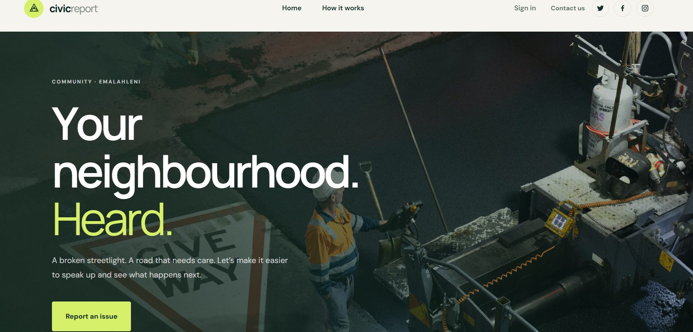
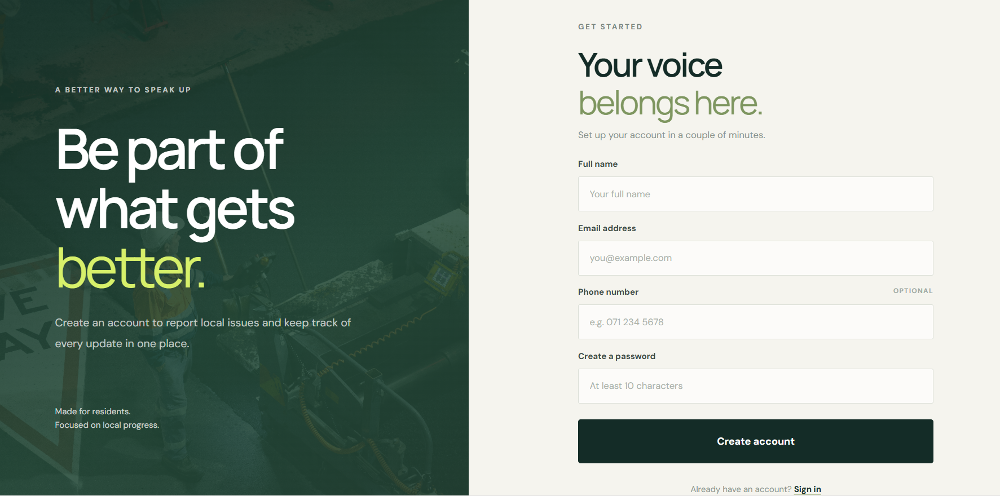
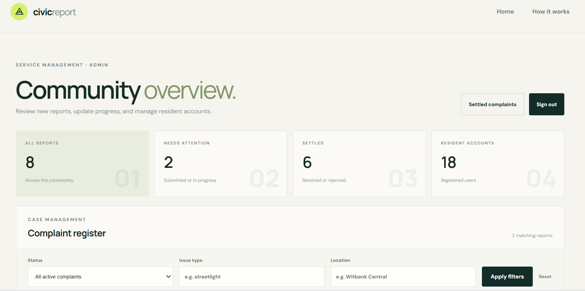

# Citizen Report

Citizen Report is a Spring Boot application with a JavaScript frontend for reporting and managing community issues.

## Features

- Residents can register, sign in, submit complaints, and track their reports.
- Administrators can manage users and complaints, update complaint statuses, and review settled reports.
- The REST API uses JWT authentication for protected requests.

## Screenshots

Screenshots are in the repository's `screenshots/` folder. Select an image to open it at full size.

### Home

[](screenshots/HOMEPAGE1.png)
[](screenshots/HOMEPAGE2.png)

### Sign in and registration

[](screenshots/SIGNIN.png)
[](screenshots/register.png)

### Dashboards

[](screenshots/userdashboard.png)
[](screenshots/admin.png)
[](screenshots/admin2.png)
[](screenshots/admin3.png)

## Run locally

You need Java 17 or later and MySQL. Create a database named `citizen_report_db`, then set the database password and JWT signing key in PowerShell:

```powershell
$env:DB_PASSWORD = "your-database-password"
$bytes = New-Object byte[] 32
$rng = [System.Security.Cryptography.RandomNumberGenerator]::Create()
$rng.GetBytes($bytes)
$env:JWT_SECRET_BASE64 = [Convert]::ToBase64String($bytes)
$rng.Dispose()
.\mvnw.cmd spring-boot:run
```

The application starts at `http://localhost:8081/`. `DB_USERNAME` defaults to `root`; `DB_URL` defaults to `jdbc:mysql://localhost:3306/citizen_report_db`. SMTP settings (`MAIL_HOST`, `MAIL_USERNAME`, and `MAIL_PASSWORD`) are optional and are only needed to send registration emails.

Keep database, email, and JWT credentials private. Do not commit them to the repository.
