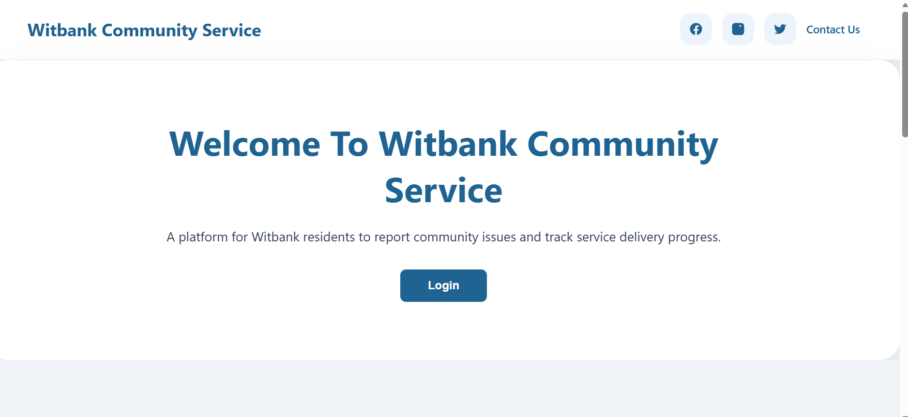
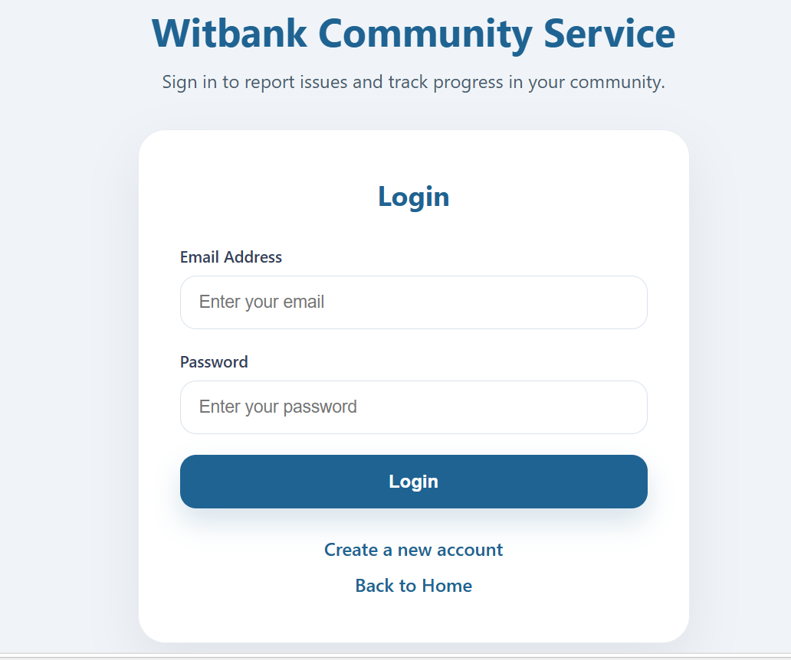
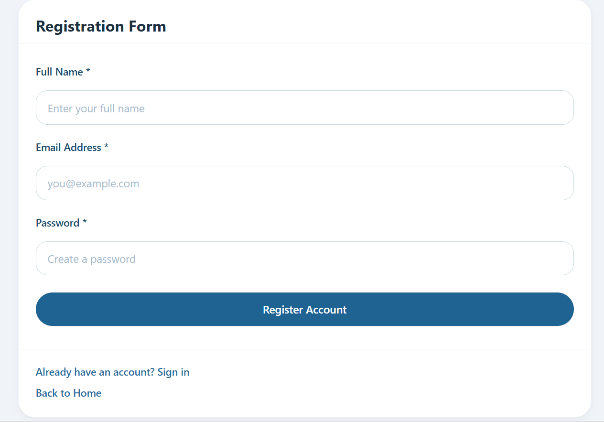
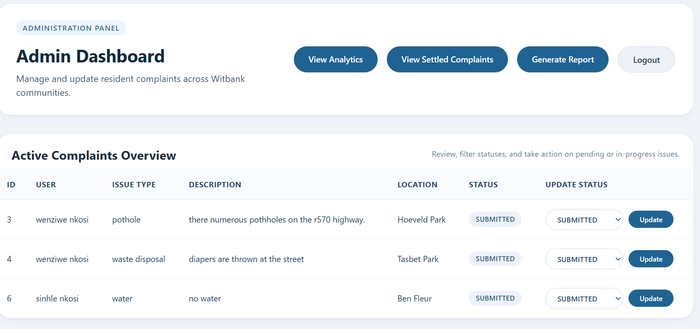
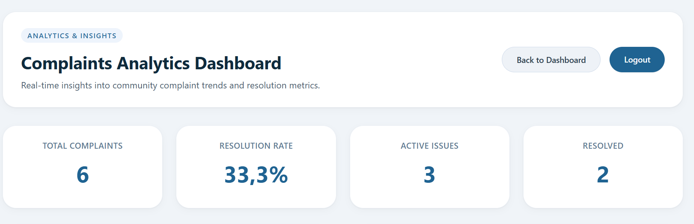
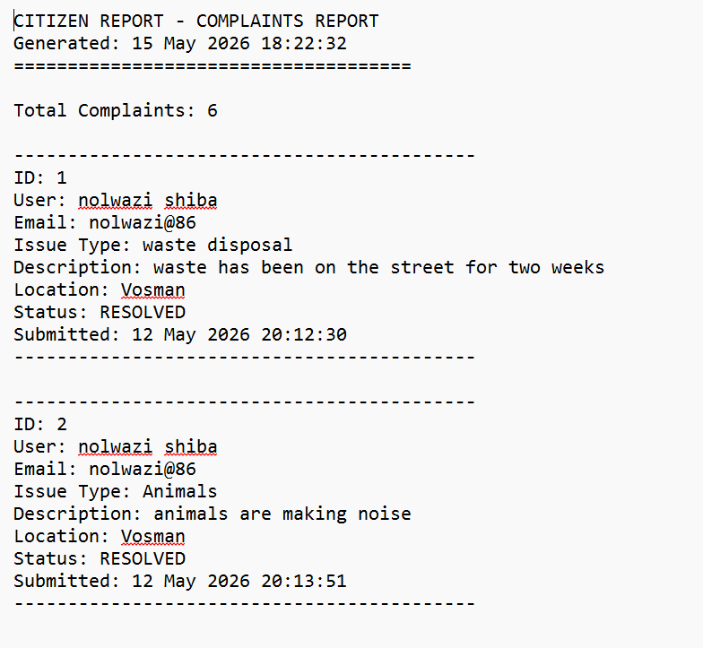
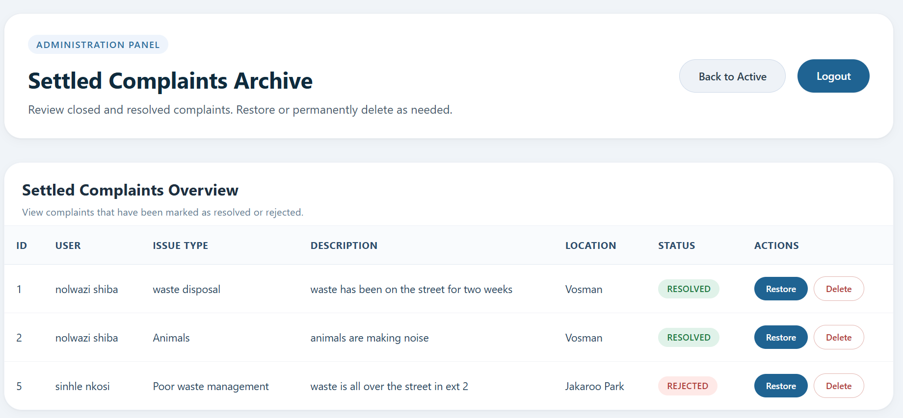

# Witbank Community Service System

A Spring Boot web application developed to improve communication between citizens and local authorities by providing a platform where residents can report community service issues, track complaint progress, and submit community feedback.

---

## Project Overview

The Witbank Community Service System enables residents to report municipal service issues such as water outages, electricity failures, road damage, waste collection problems, and other community concerns.

The system provides administrators with tools to manage complaints, monitor community issues, publish approved feedback, and generate reports for decision-making.

---

## Features

### User Features

- User Registration
- User Login
- Secure Authentication
- Submit Community Complaints
- Track Complaint Status
- View Complaint History
- Submit Community Feedback
- Delete Personal Account

### Administrator Features

- Admin Dashboard
- Manage Complaints
- Update Complaint Status
- Delete and Restore Complaints
- Publish Community Feedback
- Analytics Dashboard
- Generate Reports

---

## Security

- Spring Security Authentication
- Role-Based Authorization (Admin and User)
- BCrypt Password Encryption
- Protected Routes and Sessions

---

## Technologies Used

### Backend

- Java
- Spring Boot
- Spring MVC
- Spring Security
- Spring Data JPA

### Frontend

- HTML5
- CSS3
- Thymeleaf

### Database

- MySQL

### Development Tools

- Maven
- Git
- GitHub
- Visual Studio Code

---

## Application Screenshots

### Home Page



### Login Page



### Registration Page



### User Dashboard


### Submit Complaint


### Admin Dashboard



### Analytics Dashboard



### Reports



### Settled Complaints



---

## Project Structure

```text
src
│
├── controller
├── model
├── repository
├── security
├── service
├── templates
└── static
```

---

## Installation

### Clone the repository

```bash
git clone https://github.com/PrinceSinhle/Witbank-Community-Service-System.git
```

### Navigate to the project directory

```bash
cd Witbank-Community-Service-System
```

### Configure the database

Update the `application.properties` file with your MySQL credentials.

```properties
spring.datasource.url=jdbc:mysql://localhost:3306/community_db
spring.datasource.username=root
spring.datasource.password=your_password
```

### Run the application

```bash
mvn spring-boot:run
```

Open your browser and visit:

```
http://localhost:8080
```

---

## System Modules

### Authentication

- User Registration
- User Login
- Logout
- Password Encryption
- Role Management

### Complaint Management

Users can:

- Submit complaints
- View complaint history
- Track complaint status

Administrators can:

- Manage complaints
- Update complaint status
- Restore deleted complaints

### Feedback Management

Users can:

- Submit feedback

Administrators can:

- Review and publish approved feedback

### Analytics and Reporting

- Complaint statistics
- Community issue analysis
- Administrative reports

---

## Future Enhancements

- Email Notifications
- SMS Notifications
- File Attachments
- Interactive Maps
- Mobile Responsive Design
- REST API Integration
- Docker Deployment
- Cloud Deployment

---

## Author

**Prince Sinhle**

GitHub: https://github.com/PrinceSinhle

---

## License

This project is intended for educational and portfolio purposes.
